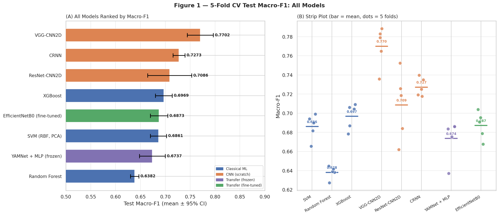
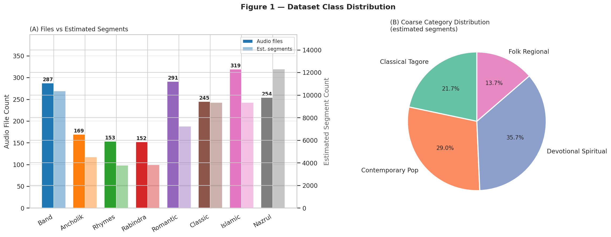

# Bangla Music Genre Classification

**A comparative audio-classification study of classical machine learning, CNNs, and transfer learning for Bangla music.**

This project explores an end-to-end workflow for classifying Bangla music into eight categories. It includes dataset auditing, audio-feature engineering, spectrogram-based deep learning, pretrained audio embeddings, model evaluation, and cross-model comparison.

> **Dataset link to add before publishing:** [Public Kaggle dataset](https://www.kaggle.com/datasets/mlfarhan/audio-classification) — replace this placeholder with the exact URL of your dataset.

## Results at a glance

In the saved outputs included with the notebooks, **VGG-CNN2D achieved the highest mean 5-fold cross-validation Macro-F1: 0.7702 ± 0.0211**. These values are the notebooks' recorded results; rerun the pipeline against the final public dataset and corrected paths before presenting them as your final reproducible benchmark.

| Model | Approach | Mean Macro-F1 | Std. across folds |
|---|---|---:|---:|
| VGG-CNN2D | CNN trained from scratch | **0.7702** | 0.0211 |
| CRNN | CNN + recurrent sequence model | 0.7273 | 0.0098 |
| ResNet-CNN2D | Residual CNN trained from scratch | 0.7086 | 0.0357 |
| XGBoost | Classical ML on engineered features | 0.6969 | 0.0136 |
| EfficientNetB0 | ImageNet-pretrained CNN, fine-tuned | 0.6873 | 0.0143 |
| SVM (RBF + PCA) | Classical ML on scaled/reduced features | 0.6861 | 0.0132 |
| YAMNet + MLP | Frozen pretrained audio embeddings + MLP | 0.6737 | 0.0210 |
| Random Forest | Classical ML on engineered features | 0.6382 | 0.0066 |

Macro-F1 is emphasized because it gives each class equal weight. The comparison notebook also reports additional metrics where available, confidence intervals, per-class results, and statistical analyses. Statistical-test outputs should be interpreted in the context of the five folds and the stored predictions available for each model.

## Project goals

- Curate and audit an audio dataset, checking file quality, class distribution, and duration.
- Extract engineered audio features such as MFCCs, chroma, spectral descriptors, zero-crossing rate, RMS, and related statistics.
- Compare classical baselines with spectrogram-based CNN architectures.
- Evaluate a pretrained YAMNet embedding pipeline and an EfficientNetB0 transfer-learning pipeline.
- Use five-fold, file/song-disjoint validation to reduce leakage from segments originating from the same audio file.
- Compare models with Macro-F1, fold-level variability, class-level performance, visualizations, and statistical tests where supported by the saved predictions.

## Dataset

The dataset used for this project is described as a dataset curated and publicly released by the project author on Kaggle. Add the exact Kaggle URL above before making this repository public. The notebooks currently define eight labels:

1. `Bangla_Band_Collection`
2. `Bangla_ancholik`
3. `Bangla_baby_rhymes`
4. `Bangla_rabindra_sangeet`
5. `Bangla_romantic`
6. `Classic_Songs_`
7. `Islamic_Melody`
8. `Nazrul_Geeti_`

The notebook's saved audit output reports **1,870 clean audio files**, approximately **60,579 estimated 10-second segments**, and about **170.8 hours** of audio. Treat these as notebook-reported figures until the pipeline is rerun against the exact Kaggle dataset linked above.

### Dataset provenance and rights

In the Kaggle dataset description, document what “created/curated” means: for example, whether the dataset was collected from multiple sources, cleaned, segmented, relabeled, or newly recorded. Include source attribution, the license/permission basis for the audio, known restrictions, and any transformation steps. Publishing a dataset publicly does not by itself establish redistribution rights for every audio file it contains.

## Notebook guide

| Order | Notebook | Purpose |
|---|---|---|
| 1 | `01_dataset_audit_and_eda.ipynb` | Discover audio files, inspect quality and duration, and summarize class distribution. |
| 2 | `02_audio_feature_extraction.ipynb` | Extract and validate engineered audio features for each class. |
| 3 | `03_classical_ml_baselines.ipynb` | Train and evaluate SVM, Random Forest, and XGBoost using five-fold CV. |
| 4a | `04a_vgg_cnn_spectrogram_classifier.ipynb` | Build spectrogram inputs and train the VGG-style CNN. |
| 4b | `04b_resnet_cnn_spectrogram_classifier.ipynb` | Train the ResNet-style CNN baseline. |
| 4c | `04c_crnn_and_cnn_comparison.ipynb` | Train the CRNN and consolidate the scratch-CNN comparisons. |
| 5a | `05a_yamnet_embedding_baseline.ipynb` | Extract pretrained YAMNet embeddings and evaluate the frozen-embedding baseline. |
| 5b | `05b_yamnet_embedding_mlp.ipynb` | Train an enhanced MLP head on the YAMNet embeddings. |
| 5c | `05c_efficientnet_b0_finetuning.ipynb` | Train and fine-tune an EfficientNetB0 spectrogram classifier. |
| 6 | `06_model_comparison_and_statistical_analysis.ipynb` | Aggregate results, create comparison figures/tables, run supported statistical tests, and generate research-style outputs. |

## How to run

The notebooks were developed around a **Kaggle notebook workflow**, including GPU-intensive stages and intermediate artifacts written by earlier stages.

1. Open the Kaggle dataset linked in the Dataset section and add it as an input to a Kaggle Notebook.
2. Open `notebooks/01_dataset_audit_and_eda.ipynb` and update its configuration cell so `AUDIO_ROOT` points to the mounted dataset directory.
3. Run the audit and feature-extraction notebooks, then the classical ML and deep-learning experiments in the order shown above.
4. For later stages, make sure the generated CSV/JSON/NumPy artifacts from earlier notebooks are available to the notebook that consumes them. Update path variables such as `FOLDS_CSV`, `INPUT_DIR`, `P4A_DIR`, `P5A_DIR`, and the `P*_DIR` variables in the comparison notebook.
5. Run the final comparison notebook only after its required result JSON files and figures have been generated or added as Kaggle inputs.

### Important reproducibility note

The supplied notebooks contain **hard-coded Kaggle paths**, including paths under the `mlfarhan`, `tarek1074`, and `imemon1044` dataset slugs for raw audio or intermediate artifacts. Before publishing, check each path and do one of the following:

- replace it with the correct path to your public dataset and to outputs produced by this repository; or
- identify and credit any upstream dataset/artifact dependency explicitly in the README and in the relevant notebook.

As currently supplied, the notebooks are a staged research workflow rather than a self-contained, one-command local application. A clean reproduction requires the correct dataset, compatible libraries, the necessary intermediate artifacts, and access to suitable compute for the training stages.

## Main tools and methods

- **Python** for data processing and experimentation
- **Librosa / SoundFile** for audio handling and feature extraction
- **NumPy / pandas / SciPy** for data and statistical operations
- **scikit-learn / XGBoost** for classical machine learning and metrics
- **TensorFlow / Keras** for CNN, MLP, and EfficientNet experiments
- **YAMNet** for pretrained audio embeddings
- **Matplotlib / Seaborn** for EDA and model-comparison plots

Exact versions and GPU requirements should be pinned in a project environment file after confirming a successful clean run. The notebooks currently install or import dependencies in their own setup cells.

## Reproducibility and limitations

- Macro-F1 and fold-level standard deviations are copied from saved notebook outputs; they are not a guarantee that a fresh run will reproduce identical values.
- Training results depend on random seeds, library versions, accelerator/runtime behavior, and data/artifact versions.
- The comparison notebook includes statistical tests, but the number of folds is small; report p-values alongside methodology and avoid overstating significance.
- Some post-hoc analyses require saved predictions. Where predictions are unavailable, the notebook may skip that test or use a previously generated figure.
- This repository contains notebooks and lightweight report artifacts, **not the raw audio corpus, large spectrogram arrays, embeddings, or trained model weights**. Obtain the dataset from Kaggle and regenerate large artifacts by running the pipeline.

## Citation

If you use this project, cite the GitHub repository and the Kaggle dataset separately. Add the final URLs once the repository and dataset are published.
